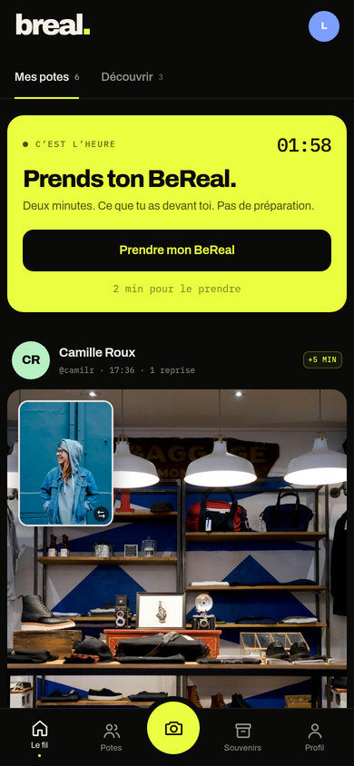

# breal.

Un clone de BeReal, fait pour un défi entre potes. Un BeReal par jour, deux minutes pour le prendre, et les retardataires assument.



## Ce qu'il y a dedans

- **Double caméra** : photo du décor + selfie en incrustation, avec inversion des deux images.
- **Deux minutes** : le moment se déclenche, un compte à rebours tourne, puis chaque post affiche son retard.
- **Un post par jour et par compte**, avec compteur de reprises.
- **Fil « Mes potes » et « Découvrir »**, réactions emoji, commentaires.
- **Souvenirs** classés par mois, profil, série de jours, potes en ligne.
- **Import de deux photos** quand il n'y a pas de caméra.
- **Mode démo** pour relancer un moment en direct devant tout le monde.
- Pensé mobile d'abord, avec une version bureau à trois colonnes.

Les comptes du fil (Léa, Hugo, Inès…) et leurs photos sont des données de démonstration pour que l'application ne soit pas vide au premier lancement.

## Lancer en local

Il faut [Bun](https://bun.sh) 1.4 ou plus récent.

```bash
bun install
bun run dev
```

L'application écoute sur **http://localhost:4000**. Le port peut être changé avec `PORT=3000 bun run dev`.

La base SQLite et les images envoyées sont créées dans `data/`, ignoré par git. Pour repartir de zéro :

```bash
rm -rf data
bun run dev
```

## Caméra et HTTPS

La caméra du navigateur demande un contexte sécurisé. En local, `localhost` suffit. Depuis un téléphone, il faut servir l'application en HTTPS (un tunnel Cloudflare ou un reverse proxy fait l'affaire).

Sans caméra — ou si l'accès est refusé — l'écran de prise de vue propose d'importer deux photos : le décor, puis le selfie. C'est aussi accessible via le bouton « Importer ».

## Stack

- **Bun.serve** et les imports HTML de Bun, sans étape de build.
- **React 19** et **TypeScript**.
- **SQLite** avec `bun:sqlite`, images stockées sur disque.
- CSS écrit à la main, typographies **Archivo** et **IBM Plex Mono**.

## Notes

C'est un prototype, pas un produit : pas de mot de passe, pas de modération, et toutes les personnes qui ont le lien voient les posts. Un seul BeReal est autorisé par compte et par jour ; pour retester, il faut supprimer son post depuis le menu de la photo.

## Crédits

- Photos de démonstration : [Unsplash](https://unsplash.com/license).
- Archivo (Omnibus-Type) et IBM Plex Mono (IBM), sous SIL Open Font License. Les licences sont dans `public/fonts/`.
